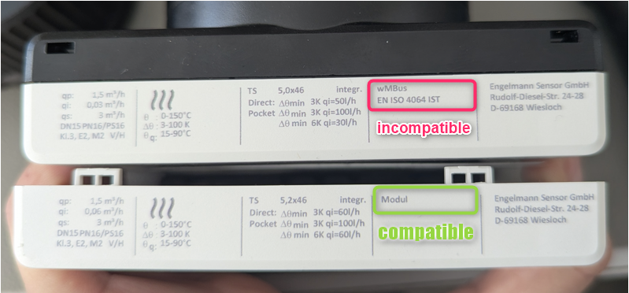
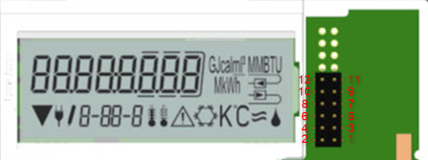
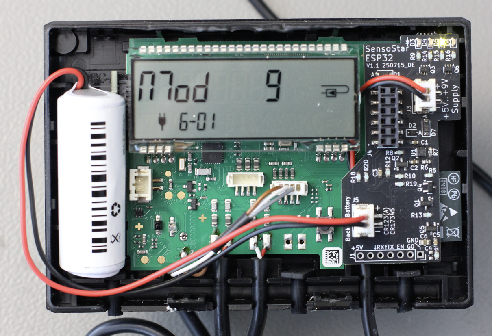
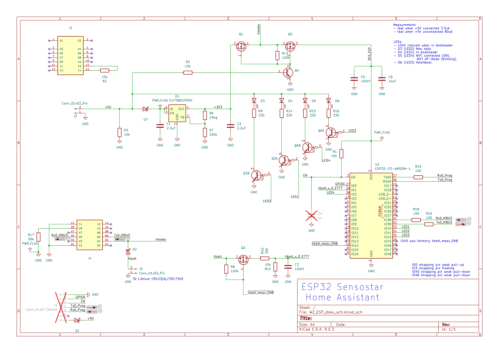
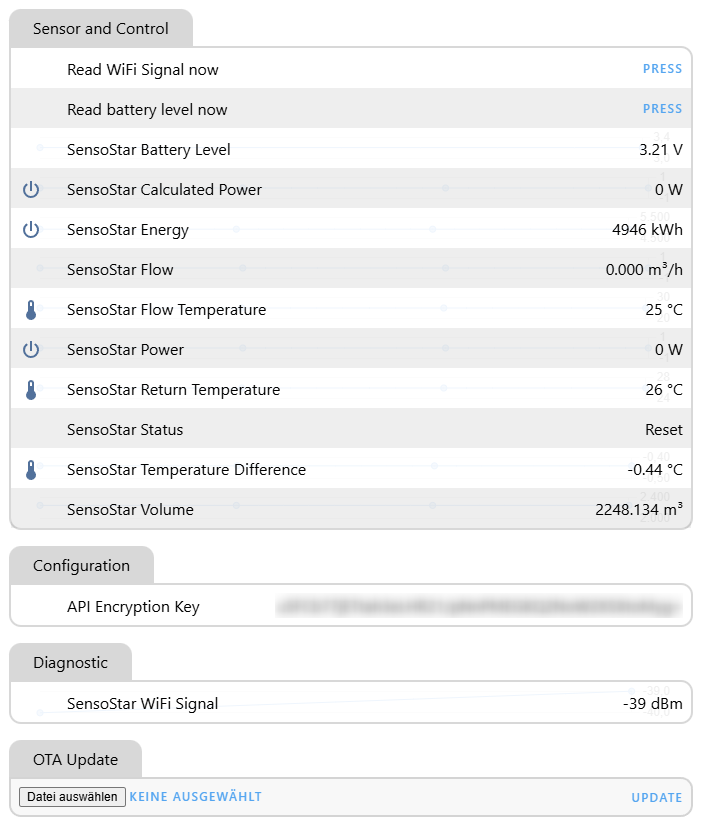
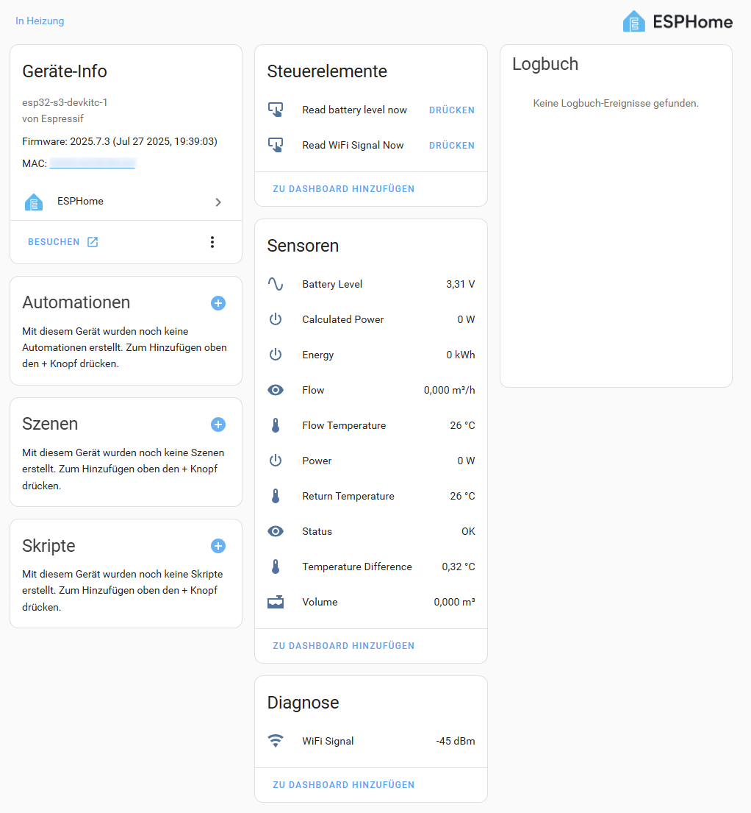

# esphome-sensostar

**Custom ESPHome Component for Engelmann SensoStar Heat Meters**

This ESPHome integration enables reading detailed heat consumption data from Engelmann SensoStar U heat meters and makes it available in Home Assistant.

---

## 🔧 Features

- 📊 **Sensor Readings**
  - Energy consumption (kWh)
  - Flow rate (m³/h)
  - Volume (m³)
  - Power (W)
  - Flow temperature (°C)
  - Return temperature (°C)
  - Temperature difference (ΔT)
  - Meter status (text)
  - Battery voltage (via ADC)
  - Three-phase SDM630 power-meter readings (RS485 variant)
  - Heat-pump deicing energy and live/daily COP (RS485 variant)

- 🧠 **Home Assistant Integration**
  - Native API support
  - OTA updates
  - Web dashboard (optional)

- 🕹 **Controls**
  - Template button for instant battery reading
  - Template button for instant Wi-Fi signal strength reading (WiFi variants)
  - MQTT broker address, port, username, password configurable at runtime
  - MQTT enable/disable switch (persisted across reboots)

- 💡 **LED Indicators**
  - Flash programming
  - Wi-Fi / Ethernet link status
  - Heartbeat (device activity)
  - New data received from the SensoStar meter

---

## 🧩 Repository Structure

The firmware uses a **modular package architecture**. A thin device file selects the hardware variant and connectivity module; all shared logic lives in reusable packages.

```
esphome-sensostar/
├── sensostar_black.yaml        # Device file: ESP32-S3 / WiFi  (black PCB)
├── sensostar_red.yaml          # Device file: ESP32-C6 / WiFi  (red PCB)
├── sensostar_white_WLAN.yaml    # Device file: ESP32-C6 / WiFi  (white PCB)
├── sensostar_white_LAN.yaml     # Device file: ESP32-C6 / Wired LAN via W5500 (white PCB)
├── sensostar_white_LAN_RS485.yaml # Wired LAN + SDM630 RS485 power meter and heat-pump sensors
└── packages/
    ├── sensostar_base.yaml     # Shared: sensors, MQTT, scripts, LED outputs
    ├── sensostar_wifi.yaml     # Connectivity: WiFi + AP-mode blink
    └── sensostar_eth.yaml      # Connectivity: W5500 Ethernet
```

Each device file defines board-specific substitutions (chip, pin mapping) and then includes two packages:

```yaml
packages:
  base:         !include packages/sensostar_base.yaml
  connectivity: !include packages/sensostar_wifi.yaml   # or sensostar_eth.yaml
```

### Hardware Variants

| File | PCB | Chip | Connectivity |
|------|-----|------|-------------|
| `sensostar_black.yaml` | Black | ESP32-S3 | WiFi |
| `sensostar_red.yaml` | Red | ESP32-C6 | WiFi |
| `sensostar_white_WLAN.yaml` | White | ESP32-C6 | WiFi |
| `sensostar_white_LAN.yaml` | White | ESP32-C6 | Wired LAN (W5500) |
| `sensostar_white_LAN_RS485.yaml` | White | ESP32-C6 | Wired LAN (W5500) + SDM630 over RS485 |

> The white PCB is available in two variants: use `sensostar_white_WLAN.yaml` for the WiFi-only version and `sensostar_white_LAN.yaml` for the wired Ethernet expansion board (W5500 via FFC adapter).
> The `sensostar_white_LAN_RS485.yaml` variant adds an Eastron SDM630 power meter and heat-pump deicing/COP sensors to the wired LAN build.

---

## 🧪 Requirements

- ESPHome installed on your system
- Home Assistant (optional but recommended)
- Sensostar heat meter — the following have been confirmed to be working:
  - SensoStar U (Engelmann)
  - SensoStar E (Engelmann)
  - Volumess VI E (Wasser-Geräte)
  - microCLIMA EVO (Maddalena)
  - microCLIMA U (Maddalena)
  - Brummerhoop F90U3
  - Molline Wingman C3

**Check compatibility:** Only units with *Modul* are working.

[](pictures/sensostar_compatibility.png)

---

## 🔌 Hardware Wiring

The SensoStar meter uses a 12-pin internal connector for communication and power. Below is the pinout and how to wire it to the ESP:

| Pin | Function | Connection |
|-----|----------|-----------|
| 1 | NC | — |
| 2 | GND | Connect to ESP GND |
| 3 | VCC | Connected to the internal battery of the meter |
| 4 | NC | — |
| 5 | RX | Connect to ESP UART TX |
| 6 | TX | Connect to ESP UART RX |
| 7 | NC | — |
| 8 | NC | — |
| 9 | NC | — |
| 10 | HW Detect (56 kΩ to GND) | Connect a 56 kΩ resistor to GND |
| 11 | NC | — |
| 12 | GND | Connect to ESP GND |

> **Note:** "NC" means *Not Connected*. Be sure to use level shifting or protective circuitry if needed, depending on your ESP model and power requirements.

[](pictures/Sensostar_internal_connector.png)

### Optional SDM630 RS485 Wiring

The `sensostar_white_LAN_RS485.yaml` variant connects an Eastron SDM630 through a 3.3 V-compatible RS485-to-UART transceiver. Do not connect the meter's RS485 terminals directly to ESP32 GPIO pins.

| ESP32-C6 / transceiver | Connection |
|------------------------|------------|
| GPIO13 (UART TX) | Transceiver DI / TX input |
| GPIO12 (UART RX) | Transceiver RO / RX output |
| ESP GND | Transceiver GND; connect a meter reference ground if provided by the meter/interface |
| Transceiver A / B | SDM630 RS485 A / B terminals, matching the labels |

The configuration uses 38,400 baud, no parity, and Modbus address 20. GPIO12 and GPIO13 are freed by disabling serial logging. No DE/RE direction-control GPIO is configured, so use an automatic-direction half-duplex RS485 adapter. If your adapter requires manual DE/RE control, add and configure a direction pin before using it. The SDM630 is a mains-connected meter; have its mains wiring installed by a qualified person.

### Powermeter and Heat-Pump Values

The RS485 variant polls the SDM630 every 2 seconds. Per-phase readings are averaged and published every 10 seconds; frequency is published every 20 seconds, while energy readings are published at 60-second intervals.

| Powermeter value | Units |
|------------------|-------|
| L1, L2, L3 current | A |
| L1, L2, L3 voltage | V |
| L1, L2, L3 active power | W |
| L1, L2, L3 power factor | Unitless |
| L1, L2, L3 apparent power | VA |
| L1, L2, L3 reactive power | var |
| L1, L2, L3 phase angle | ° |
| Frequency | Hz |
| Total power | W |
| Imported/exported active energy | kWh |
| Imported/exported reactive energy | kvarh |

The additional heat-pump sensors are derived as follows:

| Sensor | Calculation |
|--------|-------------|
| `heatpump Deicing Power` | Reports the magnitude of negative SensoStar calculated power; reports 0 W otherwise. |
| `heatpump Deicing Energy` | Integrates deicing power using the trapezoidal method and reports accumulated kWh. |
| `heatpump Daily Deicing Energy` | Integrates deicing power into a daily kWh total. |
| `heatpump Live COP - Heat Only` | SensoStar meter power divided by SDM630 total electrical power. Published only when electrical power is above 100 W, thermal output is positive, and calculated power is not negative; values above 12 are discarded. |
| `heatpump Daily COP Average - Heat Only` | Arithmetic mean of valid heating-only COP samples collected since the daily reset. |
| `heatpump Daily COP Min - Heat Only` | Minimum valid heating-only COP sample since the daily reset. |
| `heatpump Daily COP Max - Heat Only` | Maximum valid heating-only COP sample since the daily reset. |
| `heatpump Live COP` | Net thermal power divided by electrical power, including negative values during defrost. Available when electrical power is positive. |
| `heatpump Daily COP Min` | Minimum valid net live COP sample since the daily reset. |
| `heatpump Daily COP Max` | Maximum valid net live COP sample since the daily reset. |
| `heatpump Daily COP Average` | Daily net thermal energy divided by daily electrical energy, including standby and defrost. Net thermal power uses negative calculated power during defrost and the meter's power otherwise; both power readings are integrated using the trapezoidal method. |

Daily COP statistics reset at midnight using Home Assistant time. The SensoStar calculated-power sensor is derived from the heat meter's flow and temperature difference; it is not measured by the SDM630. Net COP is an estimate based on sampled power; it can be negative when defrost removes more heat than was delivered during the day. Live COP and its daily extrema have no minimum electrical-power threshold and may be noisy at low consumption.

---

## 📷 Example Hardware

### Version 1 — Black PCB (ESP32-S3)

[](pictures/Sensostar_w_ESP32_Sensostar.png)

[](pictures/ESP_Sensostar.png)

### Version 2 — Red PCB (ESP32-C6 / WiFi)

[](pictures/ESP_Sensostar_V2.png)

### Version 3 — White PCB (ESP32-C6 / WiFi or Wired LAN)

[](pictures/ESPHome_Sensostar_white_LAN.jpg)

Sensostar assembled with LAN-version

[](pictures/ESPHome_Sensostar_white_PCB.jpg)

Sensostar with ESPHome Sensostar white

[](pictures/ESPHome_Sensostar_white_LAN_PCB_with_module.jpg)

LAN PCB with soldered W5500 LAN module

---

## 🗺 Schematics

### Version 1 — Black PCB

[](pictures/ESP32_Sensostar.png)

### Version 2 — Red PCB

[](pictures/ESP32_Sensostar_V2.png)

### Version 3 — White PCB (LAN variant)

[](pictures/ESP32_Sensostar_white.png)

---

## 🌐 Interfaces

### Web Interface

[](pictures/Sensostar_ESP_WebIF.png)

### Home Assistant Dashboard

[](pictures/HA_Dash_Sensostar.png)

---

## 🚀 Setup Instructions

### 1. Install ESPHome

[ESPHome installation guide](https://esphome.io/guides/installing_esphome.html)

### 2. Clone this repository

```bash
git clone https://github.com/STB3/esphome-sensostar.git
cd esphome-sensostar
```

The `external_components` block is already included in `packages/sensostar_base.yaml` — no manual configuration needed:

```yaml
external_components:
  - source:
      type: git
      url: https://github.com/STB3/esphome-sensostar
      ref: main
    components: [ SensoStar_MBus ]
```

### 3. Create a `secrets.yaml` file

Place a `secrets.yaml` file in the same directory as the device YAML files:

```yaml
# secrets.yaml
wifi_ssid: "YourSSID"
wifi_password: "YourPassword"
api_encryption_key: "YourAPIKey"  # Generate with: openssl rand -base64 32
```

[Generate an API key online](https://www.cryptool.org/en/cto/openssl/)

### 4. Flash the firmware

Choose the file matching your hardware:

**Black PCB (ESP32-S3 / WiFi)**
```bash
esphome run sensostar_black.yaml
```

**Red PCB (ESP32-C6 / WiFi)**
```bash
esphome run sensostar_red.yaml
```

**White PCB — WiFi**
```bash
esphome run sensostar_white_WLAN.yaml
```

**White PCB — Wired LAN (W5500)**
```bash
esphome run sensostar_white_LAN.yaml
```

**White PCB — Wired LAN with SDM630 RS485 power meter**
```bash
esphome run sensostar_white_LAN_RS485.yaml
```

### 5. First-boot fallback (WiFi variants)

If no WiFi credentials are stored, the device opens an access point named **Sensostar**. Connect to it and enter your SSID and password via the captive portal. The AP-mode LED blinks rapidly until a connection is established.

### 6. Configure MQTT (optional)

MQTT is disabled by default. After the device appears in Home Assistant or the web interface, set the broker parameters under **Controls**:

1. Enter **MQTT address**, **MQTT port** (default: 1883), **MQTT username**, **MQTT password**
2. Enable the **MQTT Enabled** switch

All settings are stored in NVS and survive reboots.

---

## 📦 Repository Contents

| Path | Description |
|------|-------------|
| `components/SensoStar_MBus/` | Custom ESPHome component for M-Bus communication |
| `packages/sensostar_base.yaml` | Shared base: sensors, MQTT, scripts, LED outputs |
| `packages/sensostar_wifi.yaml` | WiFi connectivity module |
| `packages/sensostar_eth.yaml` | Wired LAN (W5500) connectivity module |
| `sensostar_black.yaml` | Device file: Black PCB, ESP32-S3, WiFi |
| `sensostar_red.yaml` | Device file: Red PCB, ESP32-C6, WiFi |
| `sensostar_white_WLAN.yaml` | Device file: white PCB, ESP32-C6, WiFi |
| `sensostar_white_LAN.yaml` | Device file: white PCB, ESP32-C6, Wired LAN |
| `sensostar_white_LAN_RS485.yaml` | Device file: white PCB, ESP32-C6, Wired LAN, SDM630 RS485, heat-pump sensors |

---

## 🔐 Security Note

This repository **does not** contain any private configurations. Be sure to:

- Use `secrets.yaml` to keep credentials out of your main config
- Add a `.gitignore` to exclude secrets from being committed

```ini
# .gitignore
secrets.yaml
*.key
*.pem
```

---

## 📫 Contact

Maintained by **STB3**  
For issues or feature requests, open an issue in the [GitHub repository](https://github.com/STB3/esphome-sensostar/issues).

---

## 📝 License

This project is open-source and licensed under the MIT License.
